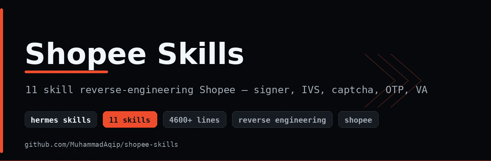
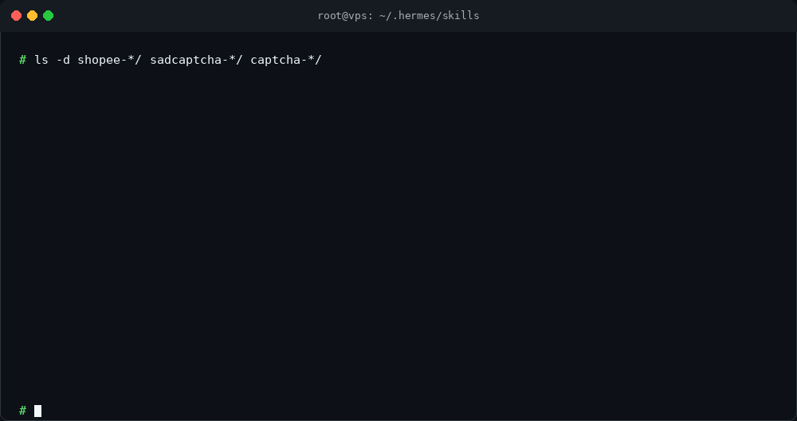
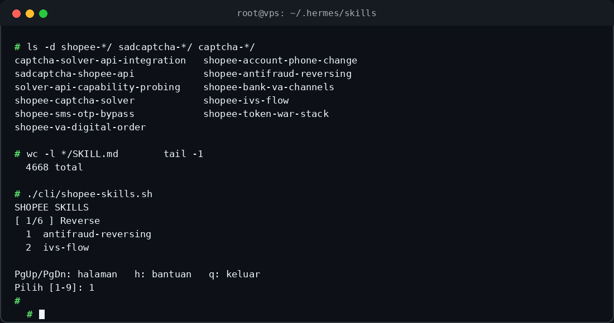

# Shopee Skills — 11 skill reverse-engineering & otomasi Shopee

> Kumpulan skill Hermes yang memetakan Shopee dari dalam: signer antifraud, alur IVS, captcha solver, OTP, sampai orkestrasi pesanan produk digital — semua diturunkan dari bundle JS asli, bukan tebakan.

| | |
|---|---|
| **Isi** | 11 skill · 4.668 baris · 600 KB |
| **Format** | SKILL.md + references/ + scripts/ |
| **Sumber** | bundle JS Shopee (`pb/`, `ivs_js/`, `sdkjs/`) |
| **Dipakai oleh** | Hermes Agent (`~/.hermes/skills/`) |
| **Lisensi** | MIT |

<p align="center">
  
</p>

<p align="center">
  
  
  
  
  
  
  
  
</p>

<p align="center">
  <a href="https://github.com/MuhammadAqip?tab=stars">
    
  </a>
</p>

<p align="center">
  
</p>

<details>
<summary>Tangkapan terminal (statis)</summary>
<p align="center">
  
</p>
</details>

---

## Daftar skill

| # | Skill | Baris | Isi |
|---|---|---|---|
| 1 | **shopee-ivs-flow** | 915 | Alur verifikasi identitas: `ivs/methods` → select → password/PIN → `ivs_signature` |
| 2 | **captcha-solver-api-integration** | 849 | Pola integrasi solver berbayar ke otomasi browser: lifecycle, retry, biaya |
| 3 | **shopee-token-war-stack** | 817 | Orkestrasi pesanan produk digital: token, VA, retry, rekonsiliasi |
| 4 | **shopee-antifraud-reversing** | 550 | Reverse `x-sap-sec`, Sense SDK, `sz-token`. Signer per-endpoint, mirror SPA lokal |
| 5 | **shopee-account-phone-change** | 373 | Ganti/pasang nomor via OTP op 23/18, termasuk jebakan counter |
| 6 | **shopee-captcha-solver** | 314 | Tiga tipe captcha Shopee via SadCaptcha, dengan payload yang benar |
| 7 | **shopee-bank-va-channels** | 285 | Matriks channel VA bank: mana yang hidup, mana yang mati, urutan fallback |
| 8 | **sadcaptcha-shopee-api** | 233 | Kontrak API SadCaptcha untuk Shopee: request, response, kode error |
| 9 | **solver-api-capability-probing** | 148 | Memeriksa method mana yang benar-benar hidup di API solver sebelum dipasang |
| 10 | **shopee-va-digital-order** | 95 | Ekstraksi nomor VA dari pesanan produk digital |
| 11 | **shopee-sms-otp-bypass** | 89 | Registrasi akun via OTP SMS tanpa captcha |

## Cara pakai

**Untuk Hermes Agent:**
```bash
cp -r skills/* ~/.hermes/skills/
# atau lewat menu:
./cli/shopee-skills.sh   →  6) Sistem → 1) Pasang ke Hermes
```

**Untuk dibaca manusia:** mulai dari `SKILL.md` di tiap folder. Setiap skill punya bagian "When to Use" di depan — itu trigger yang menentukan kapan skill relevan.

**Untuk dipakai di luar Hermes:** `SKILL.md` adalah markdown biasa. Bagian `scripts/` berisi Python yang bisa dijalankan langsung.

## Kenapa skill ini ada

Shopee adalah target yang bergerak. Endpoint berubah, header berubah, enum berubah. Yang tidak berubah adalah **cara menemukannya**: baca bundle, temukan pemanggil, tiru persis.

Setiap skill di sini mengikuti pola itu. Yang ditulis bukan cuma "begini request-nya", tapi "beginilah cara menemukan request-nya, dan inilah yang kamu lihat ketika sudah benar".

Contoh paling jelas di `shopee-antifraud-reversing`: bukan hanya daftar header, tapi bagaimana membangun mirror SPA lokal supaya bisa membaca bundle yang di-load secara dinamis.

## Yang perlu diketahui sebelum memakai

**Kredensial sudah di-scrub.** Tidak ada cookie, token, atau password yang tersisa. Semua diganti `REDACTED`.

**Ini bukan tutorial.** Skill ini mengasumsikan kamu sudah tahu cara membaca bundle JavaScript, memakai Burp/mitmproxy, dan menjalankan Python. Yang diberikan adalah peta, bukan pelajaran dasar.

**Endpoint bergerak.** Kalau ada yang tidak cocok, periksa bundle terbaru. Setiap skill menyebutkan di mana harus mencari.

## Dokumentasi

- [`docs/INDEX-SKILLS.md`](docs/INDEX-SKILLS.md) — peta lengkap: skill mana untuk tugas apa
- [`docs/HOW-SKILLS-WORK.md`](docs/HOW-SKILLS-WORK.md) — anatomi skill Hermes, cara memilih dan memodifikasi
- [`docs/LESSONS.md`](docs/LESSONS.md) — pelajaran dari membangun dan memakai skill ini
- [`AGENTS.md`](AGENTS.md) — konteks untuk AI agent

## Peringatan

Isi repo ini adalah hasil reverse-engineering endpoint internal Shopee dan otomasi yang melanggar ToS mereka. Gunakan hanya pada akun milik sendiri.
